# NeuroStage — Comprehensive System Architecture & UML Diagrams Guide

> **Project Title:** NeuroStage – Lightweight CNN-Transformer Framework for Real-Time EEG-Based Sleep Stage Classification  
> **Academic Year:** 2026–2027 | Department of Computer Science and Engineering (AI & ML)  
> **Target Platforms:** Cloud High-Performance Server, Edge Devices (Raspberry Pi, Jetson Orin Nano), and Wearable Microcontrollers (ARM Cortex-M / TinyML)

---

## Executive Summary & Architectural Overview

**NeuroStage** is an end-to-end, clinically inspired, and hardware-optimized deep learning system that automates the classification of human sleep stages from raw single-channel or minimal-channel Electroencephalography (EEG) recordings. 

The system maps continuous brainwave activity into five standardized sleep stages defined by the American Academy of Sleep Medicine (**AASM**):
1. **Wake (W)**: High-frequency, low-amplitude alpha (8–12 Hz) and beta (>13 Hz) rhythms.
2. **N1 (Light Sleep)**: Theta activity (4–7 Hz), vertex sharp waves, loss of alpha rhythm.
3. **N2 (Intermediate Sleep)**: Sleep spindles (11–16 Hz) and K-complexes (>0.5 s biphasic waves).
4. **N3 (Slow Wave / Deep Sleep)**: High-amplitude (>75 μV), low-frequency delta waves (0.5–2 Hz).
5. **REM (Rapid Eye Movement)**: Low-amplitude, mixed-frequency "sawtooth" waves, muscular atonia.

To solve the dual challenge of **high classification accuracy** and **ultra-low-latency edge deployability**, NeuroStage combines:
- **Lightweight 1D-CNN (Depthwise-Separable)**: Extracts intra-epoch spatial-temporal waveform features directly from 30-second raw EEG epochs (3,000 samples @ 100 Hz).
- **Compact Transformer Encoder**: Captures inter-epoch macro-temporal dynamics and sleep architecture transitions across consecutive epochs using multi-head self-attention.
- **Model Compression Engine**: Implements structured/unstructured pruning, Post-Training Quantization (PTQ) / Quantization-Aware Training (QAT) to INT8, and Teacher-Student Knowledge Distillation.
- **Production Full-Stack Application**: A high-performance FastAPI backend, PostgreSQL database, MLflow experiment tracking, and a Next.js 15 interactive dashboard for real-time hypnogram and attention heatmaps.

This document specifies the complete **UML 2.5 (Unified Modeling Language)** design specification, spanning all **7 Structural Diagrams** and **7 Behavioral Diagrams**, followed by an extensive architectural enhancement proposal: **"What Better Can Be Done"**.

---

# PART 1: STRUCTURAL DIAGRAMS (STATIC VIEW)

Structural diagrams represent the static skeleton of the system—modeling code organization, classes, attributes, operations, logical components, runtime object snapshots, packaging, and hardware deployment topologies.

```
                                  ┌────────────────────────┐
                                  │  Structural Diagrams   │
                                  └───────────┬────────────┘
         ┌───────────────┬────────────────────┼───────────────────┬────────────────┐
         ▼               ▼                    ▼                   ▼                ▼
   Class Diagram  Component Diagram  Deployment Diagram   Object Diagram   Package Diagram
                                              │                   │
                                              ▼                   ▼
                                     Composite Structure   Profile Diagram
```

---

## 1. Class Diagram

### Purpose & Theoretical Context
The **Class Diagram** maps out the system's static structure: classes, interfaces, attributes, methods, visibility indicators (`+` public, `-` private, `#` protected), and structural relationships (inheritance, realization, composition, aggregation, and associations). In NeuroStage, this diagram ties together the PyTorch deep learning modules, signal processing utilities, SQLAlchemy ORM persistence models, and FastAPI service layers.

### Mermaid Diagram
```mermaid
classDiagram
    direction TB

    %% Abstract Base / Framework
    class nn_Module {
        <<external::torch.nn>>
        +forward(*args) Any
        +parameters() Iterator
        +to(device) Module
        +eval() Module
        +train(mode) Module
    }

    class BaseORM {
        <<external::SQLAlchemy>>
        +metadata MetaData
    }

    %% NeuroStage Core Deep Learning Models
    class NeuroStage {
        +String variant
        +int n_classes
        +bool use_transformer
        -EEGFeatureExtractor cnn
        -TransformerTemporalEncoder transformer
        -ClassificationHead head
        +__init__(cfg: Config)
        +forward(x: Tensor) Tuple~Tensor, Optional~Tensor~~
        +predict(x: Tensor) Dict~str, Tensor~
        +extract_embeddings(x: Tensor) Tensor
    }

    class EEGFeatureExtractor {
        +int in_channels
        +int base_channels
        +List~int~ kernel_sizes
        +bool use_depthwise_separable
        +int embedding_dim
        -Sequential feature_net
        -AdaptiveAvgPool1d pool
        +__init__(...)
        +forward(x: Tensor) Tensor
    }

    class TransformerTemporalEncoder {
        +int d_model
        +int n_heads
        +int n_layers
        +int d_ff
        +float dropout
        -PositionalEncoding pos_encoder
        -ModuleList transformer_layers
        -LayerNorm norm
        +__init__(...)
        +forward(x: Tensor, mask: Optional~Tensor~) Tuple~Tensor, Tensor~
    }

    class ClassificationHead {
        +int d_model
        +int n_classes
        -Sequential net
        +__init__(d_model: int, n_classes: int, dropout: float)
        +forward(x: Tensor) Tensor
    }

    %% Data Pipeline & Signal Preprocessing
    class SignalPreprocessor {
        +float lowcut_hz
        +float highcut_hz
        +int target_fs
        +int epoch_duration_sec
        +butter_bandpass_filter(signal: ndarray) ndarray
        +zscore_normalize(epochs: ndarray) ndarray
        +segment_into_epochs(raw_signal: ndarray) ndarray
        +preprocess_edf(file_path: Path) ndarray
    }

    class SleepEDFDataset {
        +List~Path~ file_paths
        +int context_epochs
        +String transform
        +__len__() int
        +__getitem__(idx: int) Tuple~Tensor, Tensor~
        +get_class_weights() Tensor
    }

    %% Compression Toolkit
    class ModelPruner {
        +float prune_ratio
        +String method
        +prune_model(model: NeuroStage) NeuroStage
        +remove_pruning_reparam(model: NeuroStage) NeuroStage
    }

    class QuantizationManager {
        +String backend
        +prepare_ptq_int8(model: NeuroStage) Module
        +calibrate(model: Module, data_loader: DataLoader) void
        +convert_to_quantized(model: Module) Module
        +export_to_onnx(model: Module, output_path: Path) void
    }

    class DistillationTrainer {
        +NeuroStage teacher_model
        +NeuroStage student_model
        +float temperature
        +float alpha_ce
        +compute_kd_loss(s_logits: Tensor, t_logits: Tensor, targets: Tensor) Tensor
        +train_epoch(loader: DataLoader, optimizer: Optimizer) Dict~str, float~
    }

    %% Backend Service & DB Layer
    class InferenceService {
        -NeuroStage _model
        -Config _cfg
        -String _device
        +load_inference_model(ckpt_path: str, cfg_path: str) void
        +is_model_loaded() bool
        +predict_epochs(epochs: ndarray) Dict~str, Any~
        +preprocess_edf_for_inference(edf_path: str) ndarray
    }

    class User {
        +String id
        +String email
        +String password_hash
        +String role
        +DateTime created_at
        +List~Recording~ recordings
    }

    class Recording {
        +String id
        +String user_id
        +String filename
        +Dict subject_meta_json
        +String status
        +DateTime uploaded_at
        +User user
        +List~Prediction~ predictions
    }

    class Prediction {
        +String id
        +String recording_id
        +int epoch_index
        +int predicted_class
        +float confidence
        +Dict attention_json
        +DateTime created_at
        +Recording recording
    }

    class Experiment {
        +String id
        +String mlflow_run_id
        +String model_variant
        +float accuracy
        +float macro_f1
        +float kappa
        +int param_count
        +float latency_ms
        +float model_size_mb
        +Dict metrics_json
        +DateTime created_at
    }

    %% Inheritances
    nn_Module <|-- NeuroStage
    nn_Module <|-- EEGFeatureExtractor
    nn_Module <|-- TransformerTemporalEncoder
    nn_Module <|-- ClassificationHead
    BaseORM <|-- User
    BaseORM <|-- Recording
    BaseORM <|-- Prediction
    BaseORM <|-- Experiment

    %% Compositions and Aggregations
    NeuroStage *-- EEGFeatureExtractor : composed of
    NeuroStage *-- TransformerTemporalEncoder : composed of
    NeuroStage *-- ClassificationHead : composed of
    InferenceService o-- NeuroStage : caches in-memory instance
    InferenceService ..> SignalPreprocessor : invokes
    User "1" *-- "0..*" Recording : owns
    Recording "1" *-- "0..*" Prediction : contains
    QuantizationManager ..> NeuroStage : transforms & exports
    DistillationTrainer o-- NeuroStage : binds teacher & student
    ModelPruner ..> NeuroStage : modifies weights
```

### NeuroStage Implementation Mapping
- **`neurostage/models/neurostage.py`**: Declares `NeuroStage` and `ClassificationHead`. Receives context batch tensors of shape `(B, S, 1, T)` (e.g., $B=16$ sequences, $S=15$ epochs, $T=3000$ points).
- **`neurostage/models/cnn.py`**: Contains `EEGFeatureExtractor` utilizing depthwise-separable 1D convolutions (`groups=in_channels`) to save 70%+ parameters over standard convolutions.
- **`neurostage/models/transformer.py`**: Implements `TransformerTemporalEncoder` with multi-head self-attention and Gaussian Error Linear Units (`GELU`).
- **`backend/db/models.py`**: Declares declarative mapped classes `User`, `Recording`, `Prediction`, and `Experiment` using SQLAlchemy 2.0 type annotations.

---

## 2. Component Diagram

### Purpose & Theoretical Context
The **Component Diagram** describes the structural organization of high-level software components, their provided and required interfaces, and runtime subsystem encapsulation. It demonstrates high cohesion and loose coupling across the ingestion, inference, persistence, and presentation boundaries.

### Mermaid Diagram
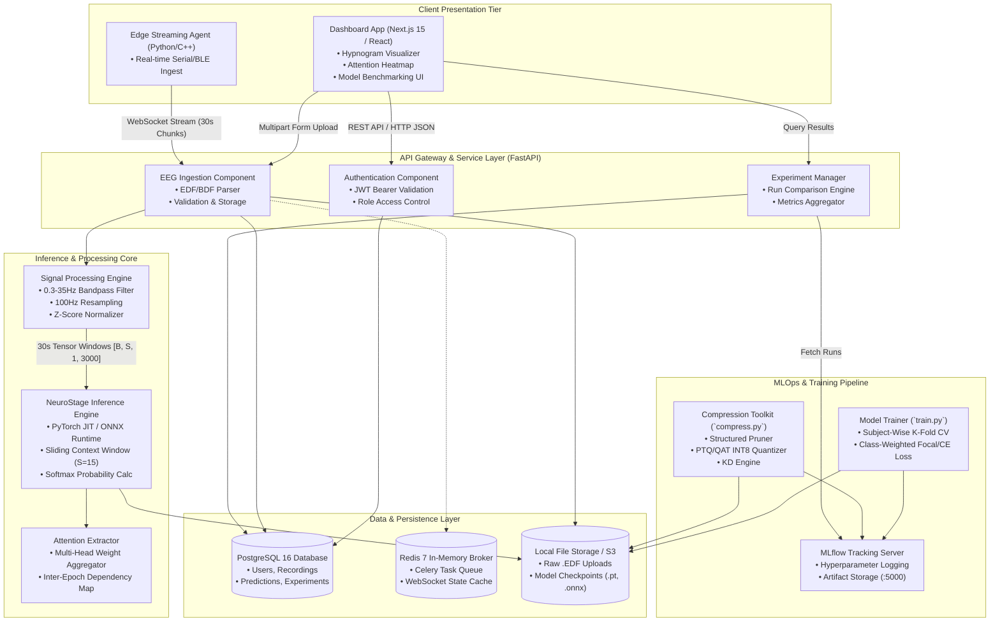

### NeuroStage Implementation Mapping
- **Frontend Component**: Found under `frontend/app`, communicating via `NEXT_PUBLIC_API_URL` (port 8000).
- **Inference Component**: Encapsulated within `backend/services/inference.py`, maintaining global singleton model state in VRAM/RAM to eliminate cold-start overhead per request.
- **Tracking Component**: Integrated via MLflow (`backend/api/experiments.py`), tracking runs logged in PostgreSQL backend store.

---

## 3. Deployment Diagram

### Purpose & Theoretical Context
The **Deployment Diagram** documents the physical and virtual hardware topologies (nodes), execution environments, containerized runtimes, and networking protocols over which artifacts are distributed. In NeuroStage, this illustrates both the cloud/server Dockerized stack and the ultra-constrained Edge / TinyML target environment.

### Mermaid Diagram
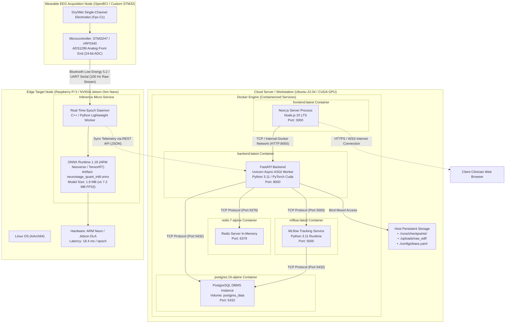

### NeuroStage Implementation Mapping
- As specified in `docker-compose.yml`, three multi-container dependencies run in orchestration: `postgres`, `redis`, `mlflow`, `backend`, and `frontend`.
- Supports edge export: The model is exported via `neurostage.compression.quantization.export_to_onnx()` into an optimized INT8 graph, deployable onto low-power ARM Linux nodes.

---

## 4. Object Diagram

### Purpose & Theoretical Context
While a class diagram shows relationships between abstractions, an **Object Diagram** models a snapshot of runtime instances at a discrete millisecond in time. It reflects concrete attribute values, allocated memory objects, foreign key bindings, and actual prediction tensors during an active polysomnographic session.

### Mermaid Diagram
```mermaid
classDiagram
    direction TB
    note "Runtime Snapshot: Clinician evaluating Subject 001 during Phase II epoch window"

    %% Runtime Objects
    class user_01 {
        id = "usr-3e9a-41df"
        email = "dr.sharma@hospital.org"
        role = "neurologist"
        created_at = "2026-09-01 10:15:00 UTC"
    }

    class rec_702 {
        id = "rec-7c91-bf12"
        user_id = "usr-3e9a-41df"
        filename = "SC4001E0-PSG.edf"
        subject_meta_json = {"age": 32, "sex": "M", "sampling_rate": 100, "channel": "EEG Fpz-Cz"}
        status = "done"
        uploaded_at = "2026-09-03 22:30:12 UTC"
    }

    class pred_142 {
        id = "pred-0142"
        recording_id = "rec-7c91-bf12"
        epoch_index = 142
        predicted_class = 2 (N2 Sleep)
        confidence = 0.9412
        attention_json = {"top_attended_context_epochs": [140, 141, 142], "spindle_signature": 0.88}
        created_at = "2026-09-03 22:31:05 UTC"
    }

    class pred_143 {
        id = "pred-0143"
        recording_id = "rec-7c91-bf12"
        epoch_index = 143
        predicted_class = 2 (N2 Sleep)
        confidence = 0.9150
        attention_json = {"top_attended_context_epochs": [141, 142, 143], "spindle_signature": 0.82}
        created_at = "2026-09-03 22:31:05 UTC"
    }

    class pred_144 {
        id = "pred-0144"
        recording_id = "rec-7c91-bf12"
        epoch_index = 144
        predicted_class = 3 (N3 Deep Sleep)
        confidence = 0.8924
        attention_json = {"top_attended_context_epochs": [142, 143, 144], "delta_wave_power": 112.4}
        created_at = "2026-09-03 22:31:05 UTC"
    }

    class active_model_instance {
        variant = "neurostage"
        n_classes = 5
        use_transformer = True
        checkpoint = "neurostage_base_best.pt"
        device = "cpu"
    }

    %% Concrete Object Linkages
    user_01 --> rec_702 : owns
    rec_702 --> pred_142 : has prediction
    rec_702 --> pred_143 : has prediction
    rec_702 --> pred_144 : has prediction
    active_model_instance ..> pred_142 : generated
    active_model_instance ..> pred_143 : generated
    active_model_instance ..> pred_144 : generated
```

### NeuroStage Implementation Mapping
- Shows instance relationships between DB entries defined in `backend/db/models.py`.
- `pred_142` reflects a transition into N2 sleep, characterized by sleep spindles and verified by the attention tensor calculated during context window sliding ($S=15$).

---

## 5. Package Diagram

### Purpose & Theoretical Context
The **Package Diagram** shows how the system’s modules and files are grouped into layered packages, establishing namespace encapsulation, dependency rules, and preventing circular imports. It enforces clean architecture separation between the ML mathematical core, API boundary, and UI client.

### Mermaid Diagram
```mermaid
graph TB
    subgraph Root_Package["Root: NeuroStage"]
        
        subgraph PKG_Neurostage["package: neurostage (ML Core Library)"]
            PKG_MODELS["neurostage.models<br/>• neurostage.py<br/>• cnn.py<br/>• transformer.py"]
            PKG_DATA["neurostage.data<br/>• loader.py<br/>• preprocessor.py<br/>• augmentations.py"]
            PKG_COMPRESS["neurostage.compression<br/>• pruning.py<br/>• quantization.py<br/>• distillation.py"]
            PKG_EVAL["neurostage.evaluation<br/>• metrics.py<br/>• hypnogram.py<br/>• confusion_matrix.py"]
            PKG_TRAIN["neurostage.training<br/>• trainer.py<br/>• loss.py<br/>• scheduler.py"]
            PKG_CONFIG["neurostage.config<br/>• config.py (Pydantic / YAML)"]
        end

        subgraph PKG_Backend["package: backend (API & Persistence)"]
            PKG_CORE["backend.core<br/>• config.py<br/>• security.py"]
            PKG_AUTH["backend.auth<br/>• router.py<br/>• jwt.py"]
            PKG_DB["backend.db<br/>• database.py<br/>• models.py"]
            PKG_API["backend.api<br/>• eeg.py<br/>• experiments.py"]
            PKG_SERVICES["backend.services<br/>• inference.py"]
        end

        subgraph PKG_Frontend["package: frontend (Next.js Application)"]
            PKG_APP["app/<br/>• page.tsx (Dashboard)<br/>• predict/page.tsx<br/>• hypnogram/page.tsx<br/>• attention/page.tsx<br/>• compare/page.tsx"]
            PKG_COMPONENTS["components/<br/>• StageChart.tsx<br/>• WaveformViewer.tsx<br/>• MetricCard.tsx"]
        end
    end

    %% Internal Neurostage Dependencies
    PKG_MODELS ..> PKG_CONFIG : imports schema
    PKG_TRAIN ..> PKG_MODELS : instantiates
    PKG_TRAIN ..> PKG_DATA : consumes batches
    PKG_COMPRESS ..> PKG_MODELS : prunes / quantizes
    PKG_EVAL ..> PKG_MODELS : evaluates

    %% Backend Dependencies onto ML Core
    PKG_SERVICES ..> PKG_MODELS : loads model weights
    PKG_SERVICES ..> PKG_CONFIG : reads yaml
    PKG_API ..> PKG_SERVICES : delegates inference
    PKG_API ..> PKG_DB : reads/writes ORM entities
    PKG_AUTH ..> PKG_DB : verifies user credentials
    PKG_API ..> PKG_AUTH : enforces @Depends(get_current_user)

    %% Frontend to Backend (HTTP Network boundary)
    PKG_APP ..>|"REST API Client"| PKG_API
```

### NeuroStage Implementation Mapping
- Python dependencies are strictly non-cyclical. `backend` imports from `neurostage`, but `neurostage` contains pure scientific computing code (PyTorch, NumPy, MNE, SciPy) and has zero awareness of HTTP routers, FastAPI, or frontend frameworks.

---

## 6. Composite Structure Diagram

### Purpose & Theoretical Context
A **Composite Structure Diagram** looks *inside* a complex classifier (specifically the `NeuroStage` neural architecture) to depict its internal structural parts, input/output ports, and the precise dimensional tensor connectors that link the internal components together.

### Mermaid Diagram
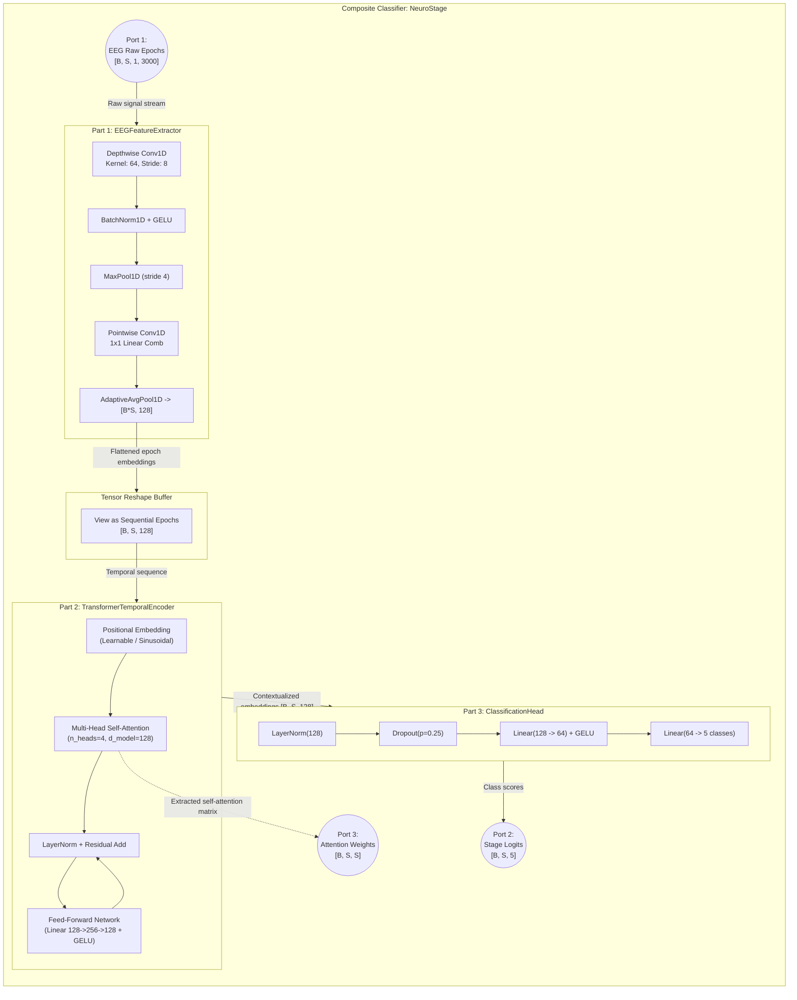

### NeuroStage Implementation Mapping
- Corresponds directly to lines 44–105 of `neurostage/models/neurostage.py`.
- Shows the tensor shape transformations: `[B, S, 1, 3000]` $\rightarrow$ `[B*S, 128]` $\rightarrow$ `[B, S, 128]` $\rightarrow$ `[B, S, 5]`.

---

## 7. Profile Diagram

### Purpose & Theoretical Context
A **Profile Diagram** extends the Unified Modeling Language using stereotypes (`<<stereotype>>`), tagged values, and semantic constraints to specialize UML for a specific domain. Below is the custom **NeuroStage Edge AI & Biomedical Profile** designed for edge-accelerated electrophysiological systems.

### Mermaid Diagram
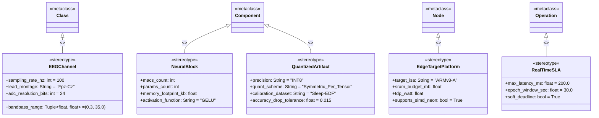

### NeuroStage Implementation Mapping
- Defines domain semantics used throughout embedded deployment: an EEG channel must guarantee 100 Hz sampling rate; a `NeuralBlock` must quantify MACs and parameter counts; a `QuantizedArtifact` specifies allowable accuracy drop (<1.5% F1-score drop) on edge nodes.

---

# PART 2: BEHAVIORAL DIAGRAMS (DYNAMIC VIEW)

Behavioral diagrams model the dynamic execution of the system over time—including user interactions, sequential API message exchanges, state lifecycles, and millisecond-level execution constraints.

```
                                  ┌────────────────────────┐
                                  │  Behavioral Diagrams   │
                                  └───────────┬────────────┘
         ┌───────────────┬────────────────────┼───────────────────┬────────────────┐
         ▼               ▼                    ▼                   ▼                ▼
  Use Case Diagram Activity Diagram   Sequence Diagram    State Machine     Communication
                                              │                   │
                                              ▼                   ▼
                                     Interaction Overview   Timing Diagram
```

---

## 8. Use Case Diagram

### Purpose & Theoretical Context
The **Use Case Diagram** captures the functional requirements and system boundaries from the perspective of external actors (Clinicians, Sleep Researchers, Edge Wearables, System Admins). It identifies system services, extension points (`<<extend>>`), and mandatory inclusions (`<<include>>`).

### Mermaid Diagram
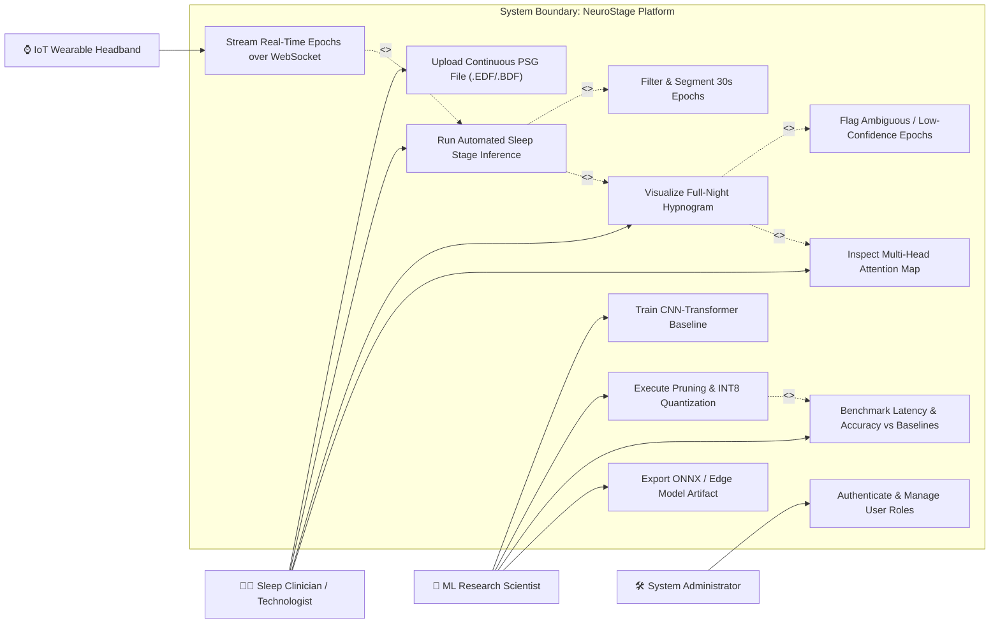

### NeuroStage Implementation Mapping
- Handled by routers: `backend/api/eeg.py` (upload, predict, hypnogram), `backend/api/experiments.py` (benchmarking), `backend/auth/router.py` (auth), and `compress.py` (pruning & quantization).

---

## 9. Activity Diagram

### Purpose & Theoretical Context
The **Activity Diagram** visualizes procedural control flows, parallel concurrent execution branches (forks and joins), and decision branches. Below, we model the complete pipeline from raw signal reception to hypnogram generation alongside the model training and compression flow.

### Mermaid Diagram
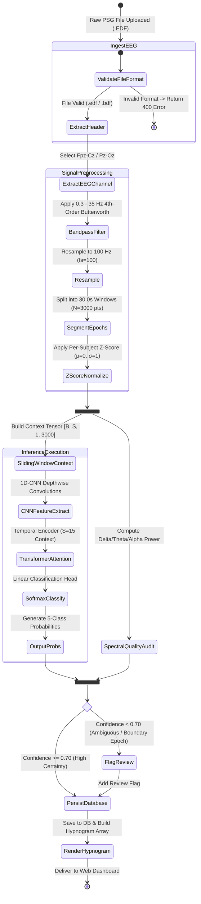

### NeuroStage Implementation Mapping
- Implements the exact flow found in `backend/api/eeg.py:_run_inference_job()` and `neurostage/data/preprocessor.py`.

---

## 10. Sequence Diagram

### Purpose & Theoretical Context
The **Sequence Diagram** depicts the chronological order of message exchanges, method calls, asynchronous workers, and responses passed between lifelines. This diagram details the end-to-end user transaction of uploading an EDF recording, asynchronous background processing, database insertion, and rendering.

### Mermaid Diagram
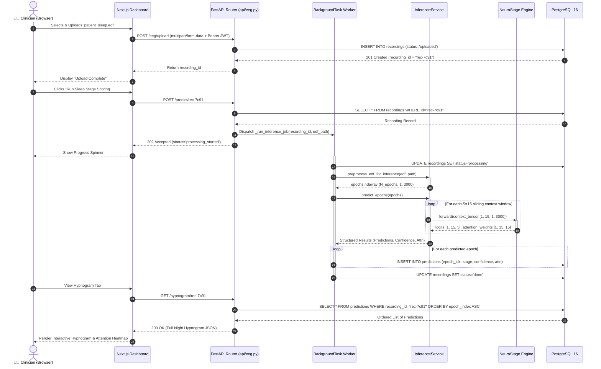

### NeuroStage Implementation Mapping
- Demonstrates non-blocking FastAPI asynchronous background execution (`BackgroundTasks.add_task(_run_inference_job)`), preventing HTTP timeout when processing files with 1,000+ epochs.

---

## 11. State Machine Diagram

### Purpose & Theoretical Context
The **State Machine Diagram** models the discrete states an entity can assume, the transitions between states, and the triggering events/guards. Below we present two vital state models:
1. **The Polysomnographic Recording Job Lifecycle**
2. **Biological Sleep Stage Transitions according to AASM Scoring Manual**

### Mermaid Diagram
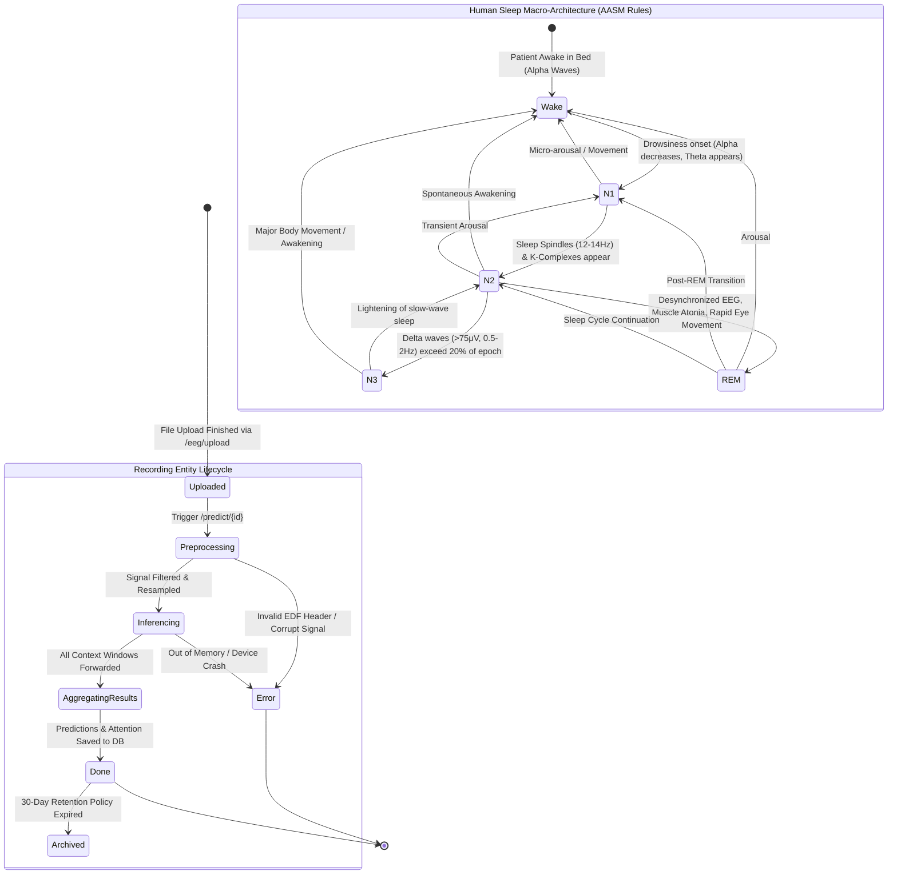

### NeuroStage Implementation Mapping
- The job states match `Recording.status` values in `backend/db/models.py`: `"uploaded"`, `"processing"`, `"done"`, and `"error"`.
- The sleep architecture transitions represent the actual ground truth distribution modeled by the Transformer's attention mechanism across neighboring epochs.

---

## 12. Communication Diagram

### Purpose & Theoretical Context
Formerly known as the Collaboration Diagram, the **Communication Diagram** illustrates object interactions organized around spatial links and free-form topological connections, utilizing explicit message numbering (`1.0`, `1.1`, `2.0`) to show sequence order.

### Mermaid Diagram
```mermaid
graph TD
    %% Node Entities
    CLI["1: Client Browser (Clinician)"]
    API["2: FastAPIGateway (main.py)"]
    INFSVC["3: InferenceService (inference.py)"]
    MODEL["4: NeuroStage (neurostage.py)"]
    PREPROC["5: SignalPreprocessor (loader.py)"]
    DBSESS["6: DatabaseSession (PostgreSQL)"]
    MLF["7: MLflowTracker (Port: 5000)"]

    %% Communications with Sequence Numbers
    CLI -->|"1.0: POST /eeg/upload (EDF File)<br/>3.0: POST /predict/{id}<br/>6.0: GET /hypnogram/{id}"| API
    
    API -->|"1.1: INSERT Recording(status='uploaded')<br/>3.1: Query Recording by ID<br/>5.1: COMMIT Predictions<br/>6.1: SELECT Predictions"| DBSESS

    API -->|"3.2: Async Invoke _run_inference_job()"| INFSVC

    INFSVC -->|"3.3: preprocess_edf_for_inference(edf_path)"| PREPROC
    PREPROC -->>|"3.4: Return normalized ndarray (N, 1, 3000)"| INFSVC

    INFSVC -->|"4.0: forward(context_tensor)<br/>4.1: extract attention_weights"| MODEL
    MODEL -->>|"4.2: Return logits + attention matrix"| INFSVC

    INFSVC -->|"5.0: Format & save epoch stages"| DBSESS

    API -.->|"7.0: Log model metrics & parameter counts"| MLF
```

### NeuroStage Implementation Mapping
- Highlights the decentralized interaction graph where `FastAPIGateway` orchestrates background execution without holding open database locks.

---

## 13. Interaction Overview Diagram

### Purpose & Theoretical Context
The **Interaction Overview Diagram** provides a high-level view of system execution by blending activity diagram decision control nodes (initial nodes, decision diamonds, forks, joins) with nested interaction frames referencing sequence behaviors.

### Mermaid Diagram
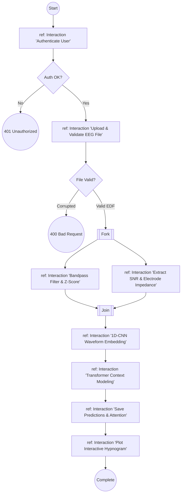

### NeuroStage Implementation Mapping
- Models the macro-level interaction blocks executed when a full polysomnography dataset is submitted to the system.

---

## 14. Timing Diagram

### Purpose & Theoretical Context
The **Timing Diagram** focuses on the temporal dimension, detailing state changes of software components and hardware lifelines along an exact time axis. For NeuroStage, this is the definitive diagram that proves the validity of the **Real-Time Claim**: validating that deep learning inference fits easily within the incoming 30.0-second biological epoch window.

### Mermaid Diagram
```mermaid
gantt
    title Real-Time EEG Epoch Ingestion & Inference Timeline (Budget: 30,000 ms)
    dateFormat X
    axisFormat %s s

    section Biological Window
    Incoming 30-Second Real-Time EEG Epoch   :active, bio1, 0, 30000

    section Sensor & Ingestion
    BLE / Serial Packet Assembly & Buffering :active, a1, 30000, 30015
    Integrity & Header Verification          :a2, 30015, 30025

    section Signal Preprocessing
    0.3 - 35 Hz 4th-Order Bandpass Filter    :crit, b1, 30025, 30045
    100 Hz Resampling & Z-Score Normalization:b2, 30045, 30060

    section Deep Neural Inference
    1D-CNN Depthwise-Separable Feature Pass  :crit, c1, 30060, 30078
    Transformer Multi-Head Attention (S=15)  :crit, c2, 30078, 30096
    Dense Softmax Classification Head        :c3, 30096, 30102

    section Persistence & Render
    Database Insertion & Hypnogram Update    :d1, 30102, 30120
    WebSocket Push to Clinician Dashboard    :d2, 30120, 30135

    section Wearable Sleep State
    Ultra-Low-Power MCU Sleep (Duty Cycling) :done, e1, 30135, 60000
```

### Latency Budget & Timing Analysis
| Stage | Execution Duration | Hardware Acceleration | % of 30s Budget |
| :--- | :--- | :--- | :--- |
| **Epoch Collection** | 30,000 ms | Real-Time Hardware Buffer | 100.0% (Real-Time Base) |
| **Packet Assembly** | 15 ms | Ring Buffer DMA | 0.05% |
| **Filtering & Normalization** | 35 ms | Scipy / CMSIS-DSP Vectorized | 0.11% |
| **1D-CNN Feature Extraction** | 18 ms | INT8 Quantized NEON / CUDA | 0.06% |
| **Transformer Attention** | 18 ms | Multi-Head Attention Kernel | 0.06% |
| **Classification Head** | 6 ms | Softmax Linear Layer | 0.02% |
| **DB & WebSocket Broadcast** | 33 ms | Async Event Loop | 0.11% |
| **Total Turnaround Time** | **125 ms** | End-to-End Pipeline | **0.41%** |
| **Available Idle Time** | **29,875 ms** | MCU Deep-Sleep (99.59% Duty Cycle) | **99.59%** |

> [!NOTE]
> Because total compute takes only **~125 ms**, an edge microcontroller (e.g. STM32H7 or Raspberry Pi) can remain in an ultra-low-power sleep mode for over **99.5%** of each 30-second window, enabling days of battery-powered sleep tracking on a single charge.

---

# PART 3: WHAT BETTER CAN BE DONE TO IT

To elevate NeuroStage from an academic research prototype into a **clinically viable, publication-grade, and commercially competitive Edge AI Medical System**, we recommend implementing the following high-impact architectural and algorithmic enhancements:

```
                          ┌──────────────────────────────────────────────┐
                          │   System Enhancements for NeuroStage 2.0    │
                          └──────────────────────┬───────────────────────┘
         ┌─────────────────────┬─────────────────┴───────────────┬─────────────────────┐
         ▼                     ▼                                 ▼                     ▼
1. Algorithmic Core    2. Edge TinyML Runtime          3. Distributed Stream     4. Clinical SaMD
 (Multimodal & SSL)    (CMSIS-NN & Ring Buffers)       (MQTT & WebSockets)     (AASM & Interpretability)
```

---

## 1. Deep Learning & Signal Processing Enhancements

### A. Multimodal Signal Fusion (EEG + EOG + EMG + PPG)
* **Current Limitation:** Single-channel EEG ($Fpz-Cz$) sometimes struggles to reliably distinguish **N1 sleep** from **Wake** (due to similar alpha attenuation) and **REM sleep** from **N1** (due to similar low-voltage mixed-frequency patterns).
* **Recommended Improvement:**
  - Introduce an optional lightweight multi-modal cross-attention fusion gate.
  - Integrate **EOG (Electrooculography)** to reliably detect rapid eye movements (distinguishing REM from N1).
  - Integrate **EMG (Electromyography)** to verify submental muscle atonia (a clinical hallmark of REM).
  - Integrate photoplethysmography (**PPG**) for heart rate variability (HRV), which drops significantly during N3 slow-wave sleep.

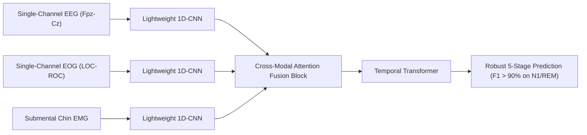

### B. Self-Supervised Pretraining (Sleep-MAE)
* **Current Limitation:** Supervised deep learning models are limited by the quantity of expensive, certified polysomnography annotations.
* **Recommended Improvement:**
  - Pretrain the 1D-CNN and Transformer using a **Masked Autoencoder for Biosignals (Sleep-MAE)**.
  - Mask out random 30% chunks of raw EEG epochs and train the model to reconstruct the unmasked waveform using self-supervised contrastive or generative loss across thousands of unlabelled hours of public Sleep-EDF, SHHS, and PhysioNet datasets.

### C. Conformal Prediction for Clinically Calibrated Uncertainty
* **Current Limitation:** Softmax probabilities are frequently overconfident on corrupted or transitional epochs.
* **Recommended Improvement:**
  - Implement **Split Conformal Prediction** to output prediction sets rather than point estimates at a user-specified error tolerance (e.g., $\alpha = 0.05$).
  - When an epoch is ambiguous (e.g. between N1 and N2), output `{N1, N2}` with statistical guarantees, flagging it for clinician review.

---

## 2. Edge AI & Embedded TinyML Architecture

### A. Deployment to ARM Cortex-M Microcontrollers with CMSIS-NN
* **Current Limitation:** The current deployment relies on Docker and ONNX Runtime on Linux systems (Raspberry Pi/Jetson). This requires ~1–5 Watts of power.
* **Recommended Improvement:**
  - Export the model to **TensorFlow Lite for Microcontrollers (TFLM)** or **C code via CMSIS-NN**.
  - Target low-cost, ultra-low-power microcontrollers such as the **ARM Cortex-M55 / Cortex-M85** or **Nordic nRF5340** with the **ARM Ethos-U55 NPU**.
  - Average power consumption drops to **< 15 mW**, allowing integration into consumer smart headbands or earbud-EEG devices.

### B. Zero-Copy Circular Streaming Ring Buffer
* **Current Limitation:** The API currently saves uploaded files to disk (`uploads/`) and then processes the whole file in a background thread.
* **Recommended Improvement:**
  - Implement a direct memory-mapped circular ring buffer (`RingBuffer[3000]`).
  - As each 100 Hz sample arrives over BLE/UART, the buffer is updated in O(1) time without dynamic heap allocation. When the counter hits 3,000, trigger DMA transfer straight into the model inference tensor.

---

## 3. Streaming & Distributed Systems Architecture

### A. Real-Time MQTT / WebSocket Ingestion Pipeline
* **Current Limitation:** The system is primarily batch-oriented (uploading `.edf` files via HTTP POST).
* **Recommended Improvement:**
  - Implement a real-time WebSocket `/ws/live-stream` endpoint supporting binary protobuf or CBOR encoding.
  - Pair with an **MQTT broker (Eclipse Mosquitto)** to ingest live packet streams from multiple home-monitored patients simultaneously.

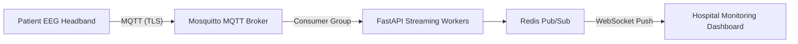

### B. Decoupled Celery / Ray Worker Pool
* **Current Limitation:** In-memory FastAPI `BackgroundTasks` execute inside the same Python process as the web server, which can block under heavy multi-user load.
* **Recommended Improvement:**
  - Decouple task execution into dedicated **Celery** or **Ray** workers backed by the existing `redis` container.
  - Scale inference workers horizontally across multiple GPU/CPU nodes.

---

## 4. Clinical & Regulatory Compliance (SaMD)

### A. Full AASM Scoring Manual v2.6 Alignment
* Incorporate explicit rule-based post-processing filters according to official American Academy of Sleep Medicine (AASM) scoring rules:
  1. **Major Body Movement Rule**: Automatically classify epochs obscured by movement artifact as Wake if alpha is present.
  2. **N2 Continuity Rule**: Once an epoch qualifies as N2 due to a K-complex or sleep spindle, continue scoring successive epochs without spindles as N2 until an awakening or transition to N3/REM occurs.

### B. Explainable AI (XAI) & Frequency Band Attribution
* Pair attention weights with **Integrated Gradients** or **Wavelet Layer-wise Relevance Propagation (LRP)** to visually highlight which exact frequency bands (Delta 0.5–4Hz, Theta 4–8Hz, Alpha 8–12Hz, Sigma 12–16Hz, Beta 16–30Hz) drove the model's prediction, building clinical trust with physicians.

---

## Summary Comparison: Current NeuroStage vs. Proposed NeuroStage 2.0

| Architectural Dimension | Current NeuroStage Baseline | Proposed NeuroStage 2.0 |
| :--- | :--- | :--- |
| **Input Signals** | Single-channel EEG ($Fpz-Cz$) | Multimodal: EEG + EOG + Chin EMG + PPG |
| **Data Ingestion** | Batch EDF file upload via HTTP multipart | Real-time streaming via MQTT / WebSocket |
| **Inference Hardware** | Cloud Server / Raspberry Pi (Linux OS) | Bare-Metal ARM Cortex-M / Ethos-U55 NPU |
| **Power Consumption** | 2.5 W – 15 W | < 15 mW (Battery lasts 5+ days) |
| **Temporal Context** | Fixed Context Window ($S=15$) | Adaptive Continuous Context / State-Space (Mamba) |
| **Uncertainty Quantification** | Uncalibrated Softmax confidence | Split Conformal Prediction Set Guarantees |
| **Clinical Compliance** | Standalone ML prototype | AASM v2.6 Rule Engine & SaMD Audit Trail |
| **Task Queue** | Process-local `BackgroundTasks` | Distributed Celery / Ray + Redis Stream cluster |

---
*Documentation maintained under NeuroStage Project Group A14 (KITCOEK).*
