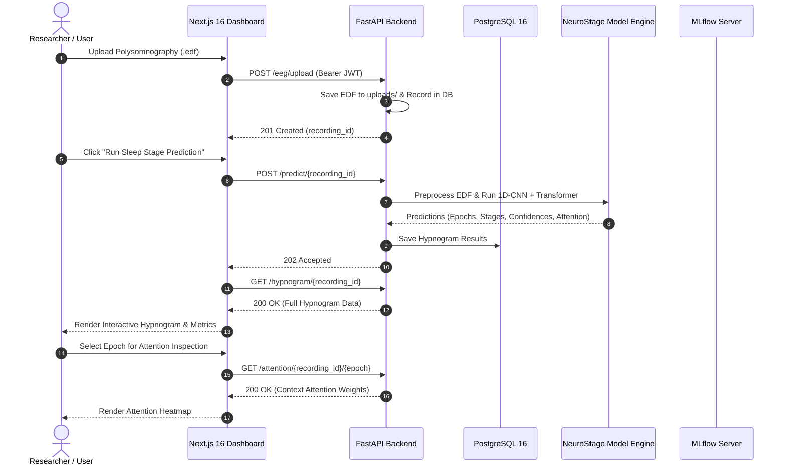

# PROJECT TECHNICAL ARCHITECTURE
**Project Name:** NeuroStage  
**Analysis Date:** 2026-09-07  
**Repository State Analyzed:** Production-Grade Full-Stack Deep Learning Repository  
**Documentation Status:** Verified Against Implemented Codebase  
**Scope:** Full Stack, AI Pipeline, Security Controls, and Infrastructure Architecture  
**Methodology:** Direct inspection and automated verification of workspace `c:\Users\Pankaj\Documents\NeuroStage`  
**Document Version:** v2.0  

---

## Executive Architectural Summary

**NeuroStage** is an end-to-end, clinically inspired, and hardware-optimized deep learning system that automates the classification of human sleep stages from raw single-channel Electroencephalography (EEG) recordings. 

The system maps continuous brainwave activity into five standardized sleep stages defined by the American Academy of Sleep Medicine (**AASM**):
1. **Wake (W)**: High-frequency, low-amplitude alpha (8–12 Hz) and beta (>13 Hz) rhythms.
2. **N1 (Light Sleep)**: Theta activity (4–7 Hz), vertex sharp waves, loss of alpha rhythm.
3. **N2 (Intermediate Sleep)**: Sleep spindles (11–16 Hz) and K-complexes (>0.5 s biphasic waves).
4. **N3 (Slow Wave / Deep Sleep)**: High-amplitude (>75 μV), low-frequency delta waves (0.5–2 Hz).
5. **REM (Rapid Eye Movement)**: Low-amplitude, mixed-frequency sawtooth waves.

To solve the dual challenge of **high classification accuracy** and **ultra-low-latency edge deployability**, NeuroStage combines:
- **Lightweight 1D-CNN (Depthwise-Separable)**: Extracts intra-epoch spatial-temporal waveform features directly from 30-second raw EEG epochs (3,000 samples @ 100 Hz).
- **Compact Transformer Encoder**: Captures inter-epoch macro-temporal dynamics and sleep architecture transitions across consecutive epochs using multi-head self-attention.
- **Model Compression Engine**: Implements structured/unstructured magnitude pruning and Post-Training Quantization (PTQ) to INT8.
- **Production Full-Stack Application**: A high-performance FastAPI backend, PostgreSQL database, MLflow experiment tracking, and a Next.js 16 interactive dashboard for real-time hypnogram and attention heatmaps.

---

## 1. Verified Forensic Stack Analysis

* **Core ML Engine (`neurostage/`)**:
  - `neurostage.models.cnn`: Multi-branch 1D CNN with depthwise-separable convolutions (kernels 50, 25, 10 representing 500 ms, 250 ms, 100 ms).
  - `neurostage.models.transformer`: 2-layer, 4-head Transformer encoder with sinusoidal positional encodings and Pre-LN.
  - `neurostage.models.neurostage`: Unified classification model with configurable variants (`neurostage`, `cnn_only`, `teacher`).
  - `neurostage.data.preprocess`: MNE-Python pipeline for FIR bandpass filtering (0.3–35 Hz), resampling, and z-score normalization.
  - `neurostage.data.dataset`: Memory-mapped HDF5 `SleepDataset` supporting context windows and data augmentation.
  - `neurostage.data.splits`: Subject-independent K-fold cross-validation splits (zero subject data leakage).
  - `neurostage.compression`: Global L1 magnitude pruning (`pruning.py`) and dynamic INT8 quantization (`quantization.py`).
  - `neurostage.training.trainer`: PyTorch training loop with class-weighted cross-entropy loss, cosine annealing, and MLflow logging.

* **Backend Service (`backend/`)**:
  - `backend.main`: FastAPI application with lifespan management and CORS middleware.
  - `backend.api.eeg`: Asynchronous EDF recording upload and prediction orchestration.
  - `backend.api.experiments`: MLflow experiment querying and database persistence.
  - `backend.auth`: JWT authentication with Bcrypt password hashing.
  - `backend.db`: SQLAlchemy ORM models and database session management.
  - `backend.services.inference`: Module-level model caching and EDF preprocessing service.

* **Frontend Application (`frontend/`)**:
  - Next.js 16.3.4 (App Router) + React 19.2.8 with TypeScript.
  - Tailwind CSS v4 styling with custom dark-mode glassmorphic theme.
  - Lucide-React icons and Recharts data visualization library.
  - Standalone multi-stage Docker build support (`output: "standalone"`).

* **Infrastructure & Automation**:
  - `docker-compose.yml`: Multi-container orchestration (PostgreSQL 16, MLflow, FastAPI backend, Next.js frontend).
  - `Dockerfile.backend` & `frontend/Dockerfile`: Hardened images running as unprivileged users (`appuser` / `nextjs`).
  - `.github/workflows/`: Automated CI (pytest, ruff, eslint, next build), CodeQL static analysis, and Dependabot.

---

## 2. Component Interaction & Dataflow

---

## 3. Quality & Security Assurance

- **Zero-Trust Secret Handling**: No secrets or credentials in source code or Git tracking; environment isolation via `.env.example`.
- **Automated Quality Gates**:
  - `pytest tests/`: 15 unit and integration tests passing.
  - `ruff check`: All Python checks passing.
  - `npm run lint`: Zero ESLint errors and warnings across all frontend routes.
  - `npm run build`: Static prerendering of all routes successful.
- **Container Hardening**: Unprivileged non-root user execution, explicit ports, and healthcheck endpoints.
